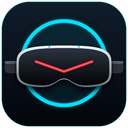
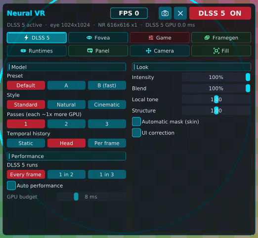
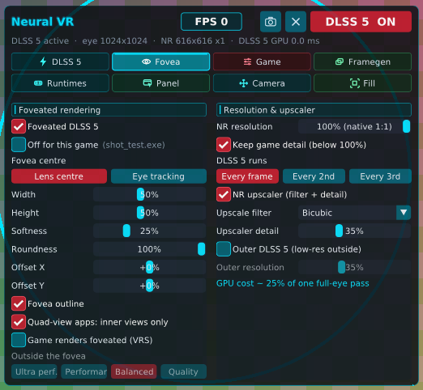
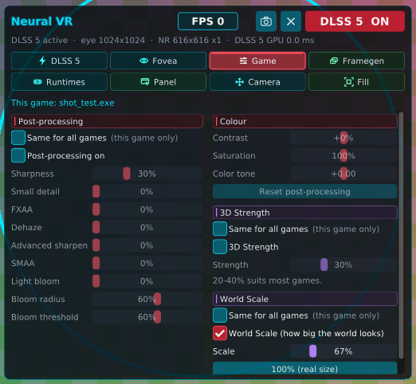
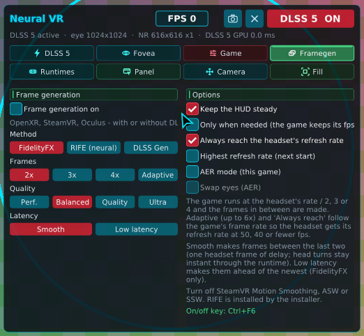
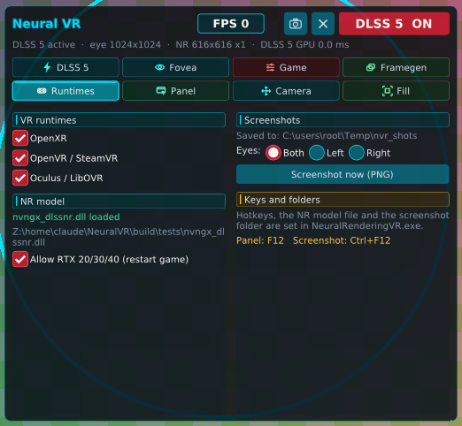
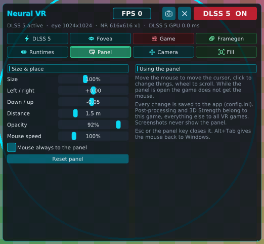
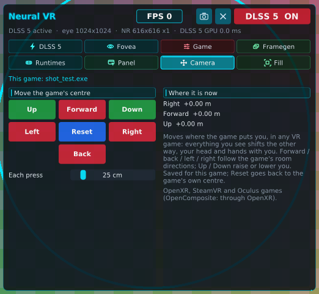
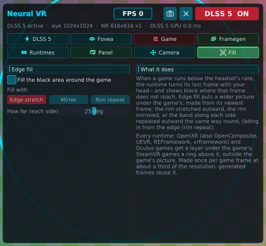

<p align="center">
  
</p>

<h1 align="center">Neural VR</h1>

<p align="center">
  <b>Universal DLSS 5 for VR</b> · post-processing · frame generation<br>
  OpenXR · SteamVR · Oculus  —  D3D9 to D3D12 · OpenGL · Vulkan  —  64- and 32-bit
</p>

---

## ✨ What it is

Neural VR puts **NVIDIA DLSS 5 neural rendering** on the picture inside your
headset, in almost any VR game or VR mod. It also adds **post-processing** and
**frame generation**, each of which works with or without DLSS 5.
Only the images sent to the headset are changed. Your desktop is never touched.

| | Feature | What you get |
|---|---|---|
| 🧠 | **DLSS 5 in VR** | Neural rendering on each eye. It is foveated: full quality where you look, lighter at the edges. |
| 🎨 | **Post-processing** | Sharpening, fine detail, SMAA, bloom, dehaze and colour. |
| 🎞️ | **Frame generation** | 2x, 3x, 4x or Adaptive, with FidelityFX-style flow, RIFE or DLSS Gen. Supports AER mods. |
| 👁️ | **Game foveation** | The game shades less outside the fovea (VRS), so it runs faster. |
| 🎥 | **Camera & fill** | Move the game's centre, and fill the black area around the image. |
| 🕶️ | **In-headset panel** | Press **F12** to change everything without taking the headset off. |

---

## 🚀 Getting started

**1 · Install the layers**
Unpack the `NeuralRenderingVR` folder somewhere it can stay. Then run
**`NeuralRenderingVR-LayerInstaller.exe`** → **Install everything**.
This one install covers every VR game, and no game folders are changed.

**2 · Get the NR model** (needed only for DLSS 5)
DLSS 5 needs NVIDIA's `nvngx_dlssnr.dll`, which is not included.

| Your GPU | Where to get it |
|---|---|
| RTX 50 | The main DLSS 5 model, from the **RenoDX Discord** |
| RTX 20 / 30 / 40 | The patched model for older cards, from the **RenoDX Discord** |
| Any RTX | The model bundled with [DLSS 5 Swapper](https://github.com/rakanki911/DLSS5-Swapper/releases) |

Open **`NeuralRenderingVR.exe`**, click **Browse…** in the green *NR model*
bar and pick the file. Then click **Self-test DLSS 5**.
Windows needs **Hardware-accelerated GPU scheduling** turned on (Settings →
Display → Graphics), followed by a reboot.

**3 · Frame generation (optional)**
In the Layer Installer:
- **Install RIFE** downloads the RIFE 4.6 model. It works on any GPU.
- **Download DLSS Gen** fetches NVIDIA's `nvngx_dlssg.dll` from their
  Streamline SDK. It needs an RTX 40 or 50 GPU.

FidelityFX needs no download.

**4 · Play**
Start a VR game. It appears under **Live** in the app.

| Key | Action |
|---|---|
| **F12** | VR panel (use the mouse) |
| **Ctrl+F9** | DLSS 5 on / off |
| **Ctrl+F6** | Frame generation on / off |
| **Ctrl+F7** | Post-processing on / off |
| **Ctrl+F12** | Screenshot |

---

## 🕶️ The VR panel

Press **F12** in any VR game. Move the mouse to aim, click to change things and
use the wheel to scroll. Every change applies live.

| | |
|---|---|
|  **DLSS 5**: look, passes, temporal history, performance |  **Fovea**: foveated DLSS 5, NR resolution, cadence |
|  **Game**: post-processing, 3D strength, world scale |  **Framegen**: method, frames, latency, AER |
|  **Runtimes**: OpenXR, SteamVR, Oculus, screenshots |  **Panel**: size, place and opacity |
|  **Camera**: move the game's centre |  **Fill**: edge fill around the game |

Settings can be saved for each game. Turn **All games** off and the change
applies only to the game that is running.

---

## 🧩 Works with

UEVR · REFramework · vrframework mods · Luke Ross mods (AER) · OpenComposite ·
XRBridge32 · OFXR-Bridge · OptiScaler · ReShade · Ultimate ASI Loader ·
Osiris VR

---

## 🛠️ Troubleshooting

| Problem | Try this |
|---|---|
| DLSS 5 doesn't start | Run **Self-test DLSS 5**. Check that HAGS is on and that the NR model is picked. |
| The game isn't listed under Live | Run **Install everything** again, and keep the agent running. |
| Low fps with DLSS 5 | Leave **Foveated** on, use 1 pass, and turn on **Auto performance**. |
| Frame gen looks wrong | Turn on *Only when needed*, or try another method in the **Framegen** tab. |
| Anything else | **Diagnostics** in the app writes a report you can share. |

Don't use it in online games with anti-cheat.

---

## 🔧 Building

MinGW-w64 (GCC 13+) on Linux or MSYS2:

```
./build.sh                  # → dist/NeuralRenderingVR/
./tests/build_tests.sh      # optional tests
```

---

## 💜 Credits

The idea of running DLSS 5 on a finished image came from
**[NeuralScreen](https://github.com/perseval-BLR/NeuralScreen)** by perseval-BLR.
None of its code is used.

---

<sub>GPL-3.0-or-later. Not affiliated with NVIDIA; NVIDIA, DLSS and RTX are NVIDIA
trademarks. No NVIDIA files are included. Licences and legal notes are in
[LEGAL.md](LEGAL.md). Every setting is explained in [SETTINGS.md](SETTINGS.md).</sub>
